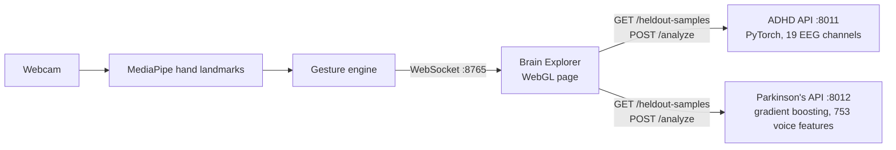

# EEGenius Brain Explorer

**Pick a patient the AI has never seen, explore their data on a holographic 3D brain with your bare hands, and get a transparent AI analysis for ADHD (from EEG) or Parkinson's (from voice).**

    

> Research and demonstration only. Nothing here is a medical diagnosis.

## Highlights

- **Touchless 3D brain.** A webcam and MediaPipe track your hand. Make a fist and move to rotate, move your palm closer or further to zoom, swipe to visit regions, and hold an open palm for a menu. Mouse and keyboard work too.
- **Real held-out patients.** The patient dropdown lists only people from each model's test split: 1,230 EEG windows from 19 children for ADHD, and 114 voice recordings from 38 people for Parkinson's. The tests prove these are exactly the rows the models were evaluated on, and never trained on.
- **Data you can see.** For ADHD, each of the 19 EEG channels lights its brain region. Brighter, larger lights mark stronger channels, and network lines join neighbouring regions.
- **Analysis, not just a label.** Every prediction comes with:
  - what drove it;
  - how the input compares with the training group;
  - a summary across the person's other recordings;
  - the dataset's true label;
  - the model's real test record;
  - plain-language guidance.
- **Honest numbers.** The app shows each model's measured performance next to its answer, including where a model is weak.

## How it works



1. **Choose a patient.** Pick ADHD or Parkinson's, then a person from the dropdown. It shows three at a time, and you scroll or filter by ID for the rest. Their values fill in.
2. **Explore** the brain by hand.
3. **Analyze.** *Run prediction* sends the input to the model server and shows the full analysis.

## Quick start

From the repo root:

```bash
python3 -m venv .venv && .venv/bin/pip install -r requirements.txt   # once
.venv/bin/python run.py                                                # camera; opens http://127.0.0.1:8765/
.venv/bin/python run.py --no-camera                                    # mouse and keyboard only
```

On Windows, use `.venv\Scripts\python.exe` in place of `.venv/bin/python`.

`run.py` does the following:
1. Starts the ADHD model server (port 8011) and the Parkinson's model server (port 8012).
2. Waits until both answer.
3. Opens the Brain Explorer.

Quitting stops all three: press `q` in the camera window, or Ctrl-C. The hand-tracking model downloads on first run. On macOS, give the app that launches Python camera access in System Settings > Privacy & Security > Camera.

| Gesture | Action |
| --- | --- |
| Fist (or pinch) and move | Rotate the brain |
| Move your palm closer / further | Zoom in / out |
| Quick fist on a light | Select that region |
| Swipe left / right | Next / previous region, strongest first |
| Swipe up / down | Next / previous step |
| Hold an open palm | Menu: overview, strongest, labels, network, hand zoom, analyze |

## Models and honest evaluation

Both models were trained with the split by person, so no person's data appears in more than one of train, validation and test. The scalers were fit on training data only, and the test people were evaluated once.

| | ADHD (EEG) | Parkinson's (voice) |
| --- | --- | --- |
| Model | 3-layer neural network on 19 channel amplitudes | Gradient-boosted trees on 753 voice features |
| Unseen test people | 51% of 2-s windows right, AUC 0.53; 58% per child | 77% of recordings right, AUC 0.87 |
| Cross-validation | 73% ± 4 on 102 children | 86% ± 3 on 214 people |
| Catches the condition / clears controls | 60% / 40% | 88% / 47% |

- **ADHD:** the model performs about at chance on its 19 test children, and the app says so beside every ADHD result.
- **Parkinson's:** about 74% of the recordings come from people with Parkinson's, so the model is compared against that baseline. It catches most cases but flags about half of healthy people.
- **Second opinion for Parkinson's:** the analysis also shows a weaker 27-feature neural network (AUC 0.69).

The Parkinson's dataset holds voice-recording features, not EEG. In it, the column named `EEG` is the voice feature DFA. So in Parkinson's mode the brain lights the speech areas as a labelled reference, and the recording's measures appear in the side panel.

## API

Each model server keeps its original endpoints (`/predict`, `/demo-samples`, `/model-info`, and for Parkinson's `/predict-full`) and adds:

| Endpoint | ADHD | Parkinson's |
| --- | --- | --- |
| `GET /heldout-samples` | Test windows: id, child, window, true label, 19 amplitudes (µV) | Test recordings: id, person, recording, true label, 27 headline features |
| `POST /analyze` | `{"data": {19 channels}, "sample_id": optional}` | `{"sample_id": ...}` or `{"features": {all 753}}` |

`/analyze` returns:
- **The prediction:** the probability and how far it sits from the 50% line.
- **Drivers:** how far the result moves when each input is replaced with the training group's typical value.
- **A comparison with the training group:** z-scores for each input.
- **A person-level summary.**
- **The model's test and cross-validation record.**

## Project layout

| Path | Contents |
| --- | --- |
| `run.py` | One command for the whole product |
| `backend/adhd/`, `backend/parkinsons/` | FastAPI model servers, model weights, scalers, model cards, held-out patient lists |
| `frontend/` | Hand tracking (`handui/`) and the Brain Explorer page (`handui/brain/viewer.html`, one self-contained WebGL file) |
| `tools/build_heldout.py` | Rebuilds the held-out lists from the raw CSVs with the training scripts' own windowing, and checks itself against their demo samples |
| `tests/`, `frontend/tests/` | Backend tests (8) and frontend tests (75) |

```bash
.venv/bin/python -m unittest discover -s tests                   # backend
cd frontend && ../.venv/bin/python -m unittest discover -s tests # frontend
.venv/bin/python tools/build_heldout.py --adhd-csv PATH/adhdata.csv --pd-csv PATH/pd_EEG_features.csv
```

## Data

- **ADHD:** `adhdata.csv`, 19-channel EEG from 121 children (ADHD and controls), recorded at 128 Hz. Each model input is the amplitude (standard deviation, µV) of every channel over one 2-second window.
- **Parkinson's:** `pd_EEG_features.csv`, the Parkinson's speech dataset of Sakar et al.: 252 people with 3 voice recordings each, and 753 features per recording.

The raw CSVs are not in this repo. Only derived files are included: the model files and the held-out rows the dropdown shows.

## Disclaimer

EEGenius Brain Explorer is a research and demonstration tool. Its outputs are not medical advice or a diagnosis. ADHD is diagnosed by qualified clinicians from history, rating scales and observation. Parkinson's is diagnosed by a neurologist. Anyone with concerns should talk to a doctor.
