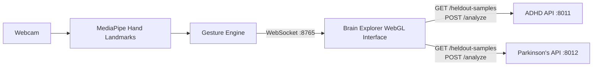

# EEGenius Brain Explorer

An interactive, AI-assisted neurological screening demonstration for exploring ADHD EEG data and Parkinson’s voice data through a hand-controlled 3D brain interface.


> **Important:** EEGenius Brain Explorer is intended for research and demonstration purposes only. It does not provide medical advice or a clinical diagnosis.

## Overview

EEGenius Brain Explorer combines machine learning, computer vision, and interactive 3D visualization in one application. Users can choose a held-out patient sample, explore the associated data on a holographic brain model, and review a transparent AI analysis.

The application supports two screening demonstrations:

- **ADHD:** analyzes 19-channel EEG amplitude features using a PyTorch neural network.
- **Parkinson’s disease:** analyzes voice-recording features using a gradient-boosted model, with a smaller neural network shown as a secondary opinion.

All patient options shown in the interface come from held-out test data and were not used to train the models.

## Key Features

- Touch-free navigation using a webcam and MediaPipe hand tracking.
- Interactive WebGL 3D brain visualization.
- ADHD analysis based on 19 EEG channels.
- Parkinson’s analysis based on voice-recording features.
- Held-out patient samples for realistic demonstrations.
- Prediction probabilities and dataset labels.
- Feature-driver explanations for each prediction.
- Comparisons with the models’ training populations.
- Person-level summaries across multiple recordings.
- Model performance and limitation information displayed alongside results.
- Mouse and keyboard controls when a camera is unavailable.

## System Architecture



The root launcher starts the two FastAPI model servers, waits until they are ready, and then opens the Brain Explorer interface.

## Technology Stack

| Area | Technologies |
| --- | --- |
| Language | Python 3.11 |
| Backend APIs | FastAPI, Uvicorn, Pydantic |
| Machine learning | PyTorch, scikit-learn, joblib |
| Computer vision | MediaPipe, OpenCV |
| Data processing | NumPy, SciPy, pandas |
| Frontend | HTML, JavaScript, WebGL2 |
| Communication | HTTP and local WebSocket |

## Project Structure

```text
.
├── backend/
│   ├── adhd/                 # ADHD API, model, scaler, and held-out samples
│   └── parkinsons/           # Parkinson's API, models, and held-out samples
├── frontend/
│   ├── handui/               # Hand tracking, gestures, bridge, and interfaces
│   │   ├── brain/            # Brain Explorer runner and WebGL viewer
│   │   └── screening/        # MotorLens hand-function screening
│   ├── examples/             # Local WebSocket bridge example
│   └── tests/                # Frontend and gesture tests
├── tests/                    # Backend tests
├── tools/                    # Held-out dataset preparation utilities
├── requirements.txt          # Python dependencies
└── run.py                    # Complete application launcher
```

## Requirements

- macOS, Linux, or Windows
- Python 3.11
- A webcam for hand controls
- A modern browser with WebGL2 support

On macOS, grant camera access to the application that launches Python under **System Settings → Privacy & Security → Camera**.

## Installation

From the project root, create a virtual environment and install the dependencies:

```bash
python3 -m venv .venv
.venv/bin/pip install -r requirements.txt
```

The first camera run may download the MediaPipe hand-landmark model.

## Running the Application

### With camera controls

```bash
.venv/bin/python run.py
```

The launcher starts:

- Brain Explorer at `http://127.0.0.1:8765/`
- ADHD API at `http://127.0.0.1:8011`
- Parkinson’s API at `http://127.0.0.1:8012`

### Without a camera

```bash
.venv/bin/python run.py --no-camera
```

This mode supports mouse and keyboard navigation.

### Stop the application

Press `q` in the camera preview window or press `Ctrl+C` in the terminal. Stopping the launcher also stops both model servers.

## Using Brain Explorer

1. Select **ADHD** or **Parkinson’s** in the interface.
2. Choose a held-out patient or recording.
3. Explore the 3D brain using hand gestures, mouse controls, or the keyboard.
4. Select **Run prediction** to view the model result and explanation.

### Hand Gestures

| Gesture | Action |
| --- | --- |
| Make a fist or pinch, then move | Rotate the brain |
| Move your palm closer or farther away | Zoom in or out |
| Make a quick fist over a light | Select a brain region |
| Swipe left or right | Move between regions |
| Swipe up or down | Move between interface steps |
| Hold an open palm | Open the radial menu |

### Mouse and Keyboard Controls

- Drag to rotate.
- Click to select.
- Scroll to zoom.
- Use arrow keys to navigate.
- Use `1`, `2`, and `3` to move between steps.
- Use `M`, `L`, `N`, `Z`, and `R` for interface actions.

## API Endpoints

Both model APIs expose their original prediction and information endpoints and provide endpoints used by Brain Explorer.

| Endpoint | Purpose |
| --- | --- |
| `GET /heldout-samples` | Returns held-out samples available in the interface |
| `POST /analyze` | Runs a prediction and returns its explanation |
| `GET /model-info` | Returns model metadata and performance information |
| `GET /demo-samples` | Returns demonstration samples |

ADHD analysis accepts 19 channel values. Parkinson’s analysis accepts a held-out sample ID or a complete feature object.

## Model Information

| | ADHD | Parkinson’s disease |
| --- | --- | --- |
| Input | 19 EEG channel amplitudes | 753 voice features |
| Primary model | Three-layer neural network | Gradient-boosted trees |
| Held-out data | 1,230 windows from 19 children | 114 recordings from 38 people |
| Reported test result | 51% window accuracy, AUC 0.53 | 77% recording accuracy, AUC 0.87 |
| Cross-validation | 73% ± 4 across 102 children | 86% ± 3 across 214 people |

The interface presents these results with context because model performance is not equivalent to clinical reliability. In particular, the ADHD model performs close to chance on its held-out test group, while the Parkinson’s model has stronger discrimination but can still flag healthy recordings incorrectly.

## Running Tests

Run backend tests from the project root:

```bash
.venv/bin/python -m unittest discover -s tests
```

Run frontend tests:

```bash
cd frontend
../.venv/bin/python -m unittest discover -s tests
```

The automated tests use synthetic hand data and do not require a camera.

## Data and Privacy

The raw source datasets are not included in this repository. The project contains trained model artifacts and derived held-out samples used by the demonstration interface.

Camera processing is performed locally. MotorLens screening results, when used, are stored locally under `frontend/data/` and are excluded from version control.

## Limitations and Responsible Use

- The application is not a medical device.
- Predictions must not be treated as diagnoses.
- ADHD assessment requires evaluation by qualified professionals using clinical history, observation, and appropriate assessment tools.
- Parkinson’s disease diagnosis requires evaluation by a qualified clinician, typically a neurologist.
- Dataset composition and model performance may not generalize to other populations.
- Anyone concerned about symptoms should consult a qualified healthcare professional.

## Team

- Adolf
- Stephen
- Elias
- Anaman
